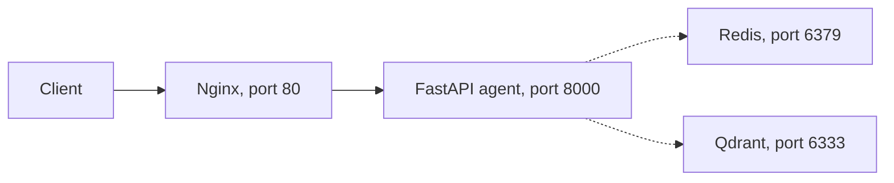

# Day 14 — Mission Answers

## Part 1 — Localhost vs. Production

### Exercise 1.1 — Anti-patterns

1. Bản develop ghi cứng API key mẫu và chuỗi kết nối cơ sở dữ liệu trong `01-localhost-vs-production/develop/app.py` (dòng 16–17). Nếu dùng thông tin thật, người có quyền đọc repo hoặc lịch sử Git có thể lấy được thông tin đó.
2. Hàm `/ask` in cả API key ra log (dòng 32). Người có quyền xem log có thể đọc được key.
3. `DEBUG` và `MAX_TOKENS` được khai báo trực tiếp trong mã nguồn. Bản production đọc các giá trị này từ biến môi trường trong `01-localhost-vs-production/production/config.py`.
4. Bản develop không có endpoint `/health`, nên công cụ giám sát thiếu một điểm kiểm tra tình trạng của ứng dụng.
5. Uvicorn dùng `localhost` và cổng `8000` cố định. Khi deploy, ứng dụng cần có thể lắng nghe trên địa chỉ và cổng do môi trường triển khai yêu cầu.
6. `reload=True` luôn bật ở bản develop. Bản production chỉ bật reload khi cấu hình `DEBUG` cho phép.

### Exercise 1.2 — Chạy bản develop

Lệnh chạy trên máy local:

```bash
curl -i -X POST 'http://localhost:8000/ask?question=Hello'
```

Kết quả: `HTTP/1.1 200 OK`

```json
{"answer":"Tôi là AI agent được deploy lên cloud. Câu hỏi của bạn đã được nhận."}
```

Đây là phản hồi của mock LLM trong bài kiểm tra local.

### Exercise 1.3 — So sánh hai phiên bản

| Tiêu chí | Develop | Production | Vì sao quan trọng |
|---|---|---|---|
| Cấu hình | Host, cổng và các giá trị cấu hình được ghi trong code. | Đọc cấu hình từ biến môi trường qua `config.py`. | Có thể thay đổi cấu hình giữa các môi trường mà không cần sửa mã nguồn. |
| Health check | Không có `/health`. | Có `GET /health`. | Nền tảng triển khai có thể dùng endpoint này để kiểm tra ứng dụng còn hoạt động. |
| Logging | Dùng `print()` và in cả API key mẫu. | Ứng dụng dùng log có cấu trúc JSON. | Dễ lọc và phân tích sự kiện khi thu thập log tập trung. |
| Shutdown | Không định nghĩa bước dọn dẹp riêng ở cấp ứng dụng. | Dùng `lifespan` để xử lý vòng đời ứng dụng. | Khi ứng dụng dừng, bước shutdown là nơi giải phóng tài nguyên của ứng dụng. |

Kết quả trên bản production: log ghi `GET /health HTTP/1.1` với `200 OK`.
Khi tôi nhấn Ctrl+C, Uvicorn ghi `Application shutdown complete` và
`Finished server process`, sau đó terminal in `KeyboardInterrupt`.

## Part 2 — Docker

### Exercise 2.1 — Dockerfile cơ bản

1. Base image là `python:3.11`.
2. Thư mục làm việc trong container là `/app`.
3. Dockerfile copy `requirements.txt` và cài dependencies trước khi copy mã nguồn. Khi chỉ sửa `app.py`, Docker có thể dùng lại lớp cài dependencies trong cache.
4. `ENTRYPOINT` xác định chương trình chính của container. Khi dùng cùng `ENTRYPOINT`, `CMD` thường cung cấp đối số mặc định. Khi chỉ dùng `CMD`, nó xác định lệnh mặc định và có thể được thay bằng lệnh truyền vào `docker run`. Bản develop dùng `CMD ["python", "app.py"]`.

### Exercise 2.2 — Build và chạy image develop

Gửi `POST /ask?question=What%20is%20Docker%3F` đến `localhost:8000`.
Kết quả: `HTTP/1.1 200 OK`.

```json
{"answer":"Container là cách đóng gói app để chạy ở mọi nơi. Build once, run anywhere!"}
```

### Exercise 2.3 — Multi-stage build

Stage `builder` cài công cụ build và thư viện Python. Stage `runtime` dùng
`python:3.11-slim`, copy thư viện đã cài và mã ứng dụng, rồi chạy bằng user
`appuser`. Công cụ build như `gcc` nằm ở stage `builder`, nên không chiếm
dung lượng trong image cuối.

| Image | Disk usage | Content size |
|---|---:|---:|
| `my-agent:develop` | 1.670 MB | 426 MB |
| `my-agent:advanced` | 240 MB | 57,4 MB |

Theo cột Disk usage của `docker images my-agent`, bản advanced giảm khoảng
85,6% so với bản develop, tính theo `(1670 - 240) / 1670 × 100`.

### Exercise 2.4 — Docker Compose



Nginx nhận HTTP và chuyển tiếp đến agent qua mạng nội bộ của Compose.
Các đường nét đứt thể hiện quan hệ phụ thuộc khi khởi động. Redis là dịch vụ
cache và Qdrant là cơ sở dữ liệu vector. Hai request dưới đây kiểm tra tuyến
Nginx → agent với mock LLM.

| Request qua Nginx | Kết quả quan sát |
|---|---|
| `GET /health` | `200 OK`, `status: ok`, `version: 2.0.0` |
| `POST /ask` với `{"question":"Explain microservices"}` | `200 OK`, phản hồi mock: “Agent đang hoạt động tốt! (mock response) Hỏi thêm câu hỏi đi nhé.” |

Tôi đã dừng stack bằng `docker compose -p k5-day14-docker down`.

## Part 3 — Cloud Deployment

### Exercise 3.1 — Railway

Tôi deploy agent trong `06-lab-complete/` lên Railway và kết nối với
service Redis trong cùng project. URL public: https://optimistic-compassion-production-057e491a.up.railway.app

Tôi chạy bốn lệnh kiểm tra từ Ubuntu: `/health` trả `200`, `/ready` trả
`200`, `POST /ask` thiếu key trả `401`, và `POST /ask` có key trả `200`.
Xem lệnh và ảnh bằng chứng trong [DEPLOYMENT.md](DEPLOYMENT.md).

### Exercise 3.2 — So sánh Railway và Render

Ví dụ `railway.toml` cấu hình build và deploy cho một service. Ví dụ
`render.yaml` dùng Blueprint để khai báo nhiều service, chọn Python
runtime và đặt lệnh Uvicorn nghe trên `$PORT`. Render dùng `sync: false`
cho biến cần điền trên dashboard. Cả hai ví dụ đều cấu hình `/health`.
Railway đã ngừng cho service mới dùng Config-as-code, nên tôi đặt cấu
hình triển khai trực tiếp trên dashboard và giữ `railway.toml` trong repo.

### Exercise 3.3 — Pipeline Cloud Run

Cloud Build chạy `pytest` trước để kiểm tra mã nguồn.
Nếu test đạt, pipeline build Docker image và đẩy image lên registry.
Sau khi push, `gcloud` deploy image lên Cloud Run.
`service.yaml` mô tả cấu hình service, gồm cổng container và giới hạn tài nguyên.

## Part 4 — API Security

### Exercise 4.1 — API key

Tôi gửi hai request `POST /ask` với cùng nội dung. Log của server ghi:

```text
"POST /ask HTTP/1.1" 401 Unauthorized
"POST /ask HTTP/1.1" 200 OK
```

Request thiếu `X-API-Key` trả `401`. Request có API key demo hợp lệ trả `200`.

### Exercise 4.2 — JWT

Tôi gửi thông tin đăng nhập của tài khoản demo `student` tới `POST /auth/token`
và lưu `access_token` vào biến `TOKEN`. Sau đó tôi gửi JWT qua header
`Authorization: Bearer $TOKEN` tới `POST /ask`. Các request hợp lệ trả `200`.

### Exercise 4.3 — Rate limit

Tôi gửi liên tiếp 12 request với JWT của `student`. Request 1–10 trả `200`,
request 11 và 12 trả `429`. Trích phản hồi của request 11:

```text
HTTP/1.1 429 Too Many Requests
x-ratelimit-limit: 10
x-ratelimit-remaining: 0
retry-after: 59

{"detail":{"error":"Rate limit exceeded","limit":10,"window_seconds":60,"retry_after_seconds":59}}
```

### Exercise 4.4 — Cost guard

Bản demo kiểm tra ngân sách trước khi gọi mock LLM rồi ghi nhận chi phí dựa
trên số token ước tính. Rate limit giới hạn số request trong một khoảng
thời gian. Cost guard kiểm soát tổng chi phí, vì các request có thể dùng
số token khác nhau.

Với thiết kế Redis cho ngân sách 10 USD/tháng, dùng key
`budget:<user_id>:<YYYY-MM>` để lưu chi phí của từng người dùng trong tháng.
Trước khi gọi model, kiểm tra chi phí hiện tại cộng chi phí ước tính.
Nếu tổng vượt 10 USD, từ chối request với `402`. Nếu còn ngân sách, giữ
trước khoản ước tính rồi đối soát với chi phí thực tế sau khi xử lý. Bước
kiểm tra và giữ ngân sách cần thực hiện nguyên tử trong Redis để các request
đồng thời không cùng vượt ngân sách. Sang tháng mới, hệ thống dùng key mới
và đặt thời hạn cho key cũ để dọn dữ liệu.

## Part 5 — Scaling & Reliability

### Exercise 5.1 — Health và readiness

`GET /health` và `GET /ready` đều trả `200 OK` sau khi agent khởi động.
`/health` cho biết tiến trình còn hoạt động. `/ready` cho biết agent đã
sẵn sàng nhận traffic. Một agent có thể vẫn hoạt động trong khi đang
chờ khởi tạo hoặc phục hồi kết nối tới dịch vụ phụ thuộc.

### Exercise 5.2 — Graceful shutdown

Khi tôi nhấn Ctrl+C, log ghi `Graceful shutdown initiated` rồi
`Shutdown complete`. Bài kiểm tra này quan sát quá trình dừng bằng
SIGINT. SIGTERM sẽ được kiểm tra riêng ở Part 6.

### Exercise 5.3 — Stateless design

Mỗi instance có bộ nhớ riêng. Nếu lưu lịch sử hội thoại trong RAM,
request tiếp theo có thể đến một instance không có lịch sử của phiên đó.
Lưu lịch sử theo `session_id` trong Redis cho phép mọi instance truy cập
cùng dữ liệu.

### Exercise 5.4 — Load balancing

Tôi chạy ba bản sao của service `agent` sau Nginx trên cổng `8080`.
Lần đầu script trả `502 Bad Gateway` khi cả ba agent còn ở trạng thái
`health: starting`. Tôi chạy lại Compose với `--wait`, xác nhận cả ba
agent đã `healthy`, rồi chạy lại script. Năm request lần lượt được xử lý
bởi `instance-96903d`, `instance-788349`, `instance-1a4029`,
`instance-96903d` và `instance-788349`.

### Exercise 5.5 — Kiểm tra stateless

`python test_stateless.py` gửi 5 request trong cùng một phiên. Sau khi
cả 3 instance đã phục vụ request, script đọc lại được đủ 10 tin nhắn
gồm 5 câu hỏi và 5 câu trả lời. Kết quả xác nhận lịch sử phiên được
chia sẻ qua Redis giữa các instance.

## Part 6 — Production-ready agent

Tôi chạy `python check_production_ready.py` trong `06-lab-complete/`
bằng Python 3.11 trên Ubuntu WSL2, với Docker đang chạy. Image có dung
lượng 273 MB. Khi nhận SIGTERM trong lúc xử lý request, agent vẫn trả
200 và thoát với mã 0. `docker stop` hoàn tất trong 0,6 giây với mã 0.

```text
  📋 Checklist Deliverable
     ✅ Dockerfile (multi-stage, < 500 MB)
     ✅ docker-compose.yml (agent + redis)
     ✅ .dockerignore
     ✅ Health check endpoint (GET /health)
     ✅ Readiness endpoint (GET /ready)
     ✅ API Key authentication
     ✅ Rate limiting
     ✅ Cost guard
     ✅ Config từ environment variables
     ✅ Structured logging
     ✅ Graceful shutdown
     ✅ Public URL ready (Railway / Render config)
----------------------------------------------------------------
  Result: 12/12 tiêu chí đạt · 41/41 checks passed
  🎉 PASS 12/12 — PRODUCTION READY! Deploy nào!
```

## AI log

- Part 1: Tôi hỏi ChatGPT cách chạy hai phiên bản, kiểm tra endpoint và diễn
  giải log khi dừng server. Tôi tự chạy các lệnh trong Ubuntu và đối chiếu
  kết quả với phản hồi HTTP và log trên máy.

- Part 2: Tôi dùng ChatGPT để đối chiếu lệnh Docker với cấu trúc repo và kiểm tra cách tính phần trăm giảm dung lượng. Tôi tự build image, chạy Compose, gọi các endpoint và lấy số liệu từ terminal của mình.

- Part 4: Tôi dùng ChatGPT để đối chiếu lệnh kiểm tra API key, JWT và rate limit, đồng thời làm rõ cách thiết kế cost guard với Redis. Tôi tự chạy các request và kiểm tra trạng thái 401, 200 và 429 từ kết quả thực tế.

- Part 5: Tôi dùng ChatGPT để phân tích lỗi 502 và chọn cách đợi các container đạt trạng thái healthy. Tôi tự chạy lại Compose và script, rồi xác nhận 5 request qua 3 instance và đủ 10 tin nhắn.

- Part 6: Tôi dùng ChatGPT để hướng dẫn cấu hình môi trường Python 3.11
  và nhận các đoạn mã để hoàn thiện agent, tích hợp Redis, xây image Docker
  và cấu hình Railway. Tôi áp dụng các thay đổi vào bản fork, tự kiểm tra
  API key và trạng thái khi dừng Redis, rồi chạy script chấm trên máy để
  xác nhận kết quả `PASS 12/12`.

- Part 3: Tôi dùng ChatGPT để được hướng dẫn cấu hình Railway, xử lý lỗi truy cập domain và đối chiếu cấu hình Railway, Render và Cloud Run. Tôi tự deploy và kiểm tra bốn mã HTTP trên URL public.
